# Home Network Security Lab

A hands-on home lab where I built a small virtual network and secured it end to end: a **pfSense** firewall, **Snort** intrusion detection, **Wireshark** traffic analysis, and an **nmap** vulnerability scan. Everything runs in **VirtualBox** on a single laptop.

I built this to understand how the core layers of network defence actually fit together, by configuring each one myself and then testing that it works, rather than just reading about them.

---

## Architecture


   ```mermaid
flowchart TD
    NET["Internet"]
    WAN["VirtualBox NAT (WAN)"]
    FW["pfSense Firewall + Snort IDS<br/>em0 WAN (DHCP) &nbsp;|&nbsp; em1 LAN 192.168.1.1"]
    LAN["Internal Network &quot;labnet&quot;"]
    HOST["Ubuntu 24.04 host<br/>192.168.1.100<br/>Wireshark + nmap"]

    NET --> WAN --> FW --> LAN --> HOST
```


- **pfSense** sits between the internet and the internal network. Everything to and from the Ubuntu machine passes through it.
- The **Ubuntu** VM is the "device on the network". It gets its IP address from pfSense by DHCP and reaches the internet only through the firewall.
- The two VMs are joined by a private VirtualBox **Internal Network** (`labnet`), so the lab never touches my real home network.

## Tools used

| Tool | Role |
|------|------|
| VirtualBox | Virtualisation (runs both VMs) |
| pfSense CE 2.9 | Firewall / router |
| Snort | Intrusion detection system (IDS) |
| Wireshark | Packet capture and analysis |
| nmap | Port and service scanning |
| Ubuntu 24.04 LTS | The protected host |

---

## 1. The environment

pfSense running as the firewall, with a WAN interface (DHCP from VirtualBox NAT) and a LAN interface serving the internal network on `192.168.1.1`.

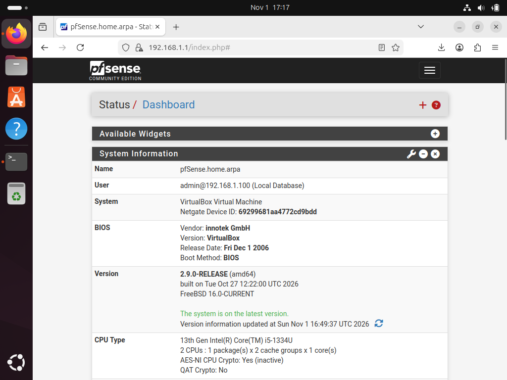

The Ubuntu host receives `192.168.1.100` from the pfSense DHCP server, confirming it sits behind the firewall:

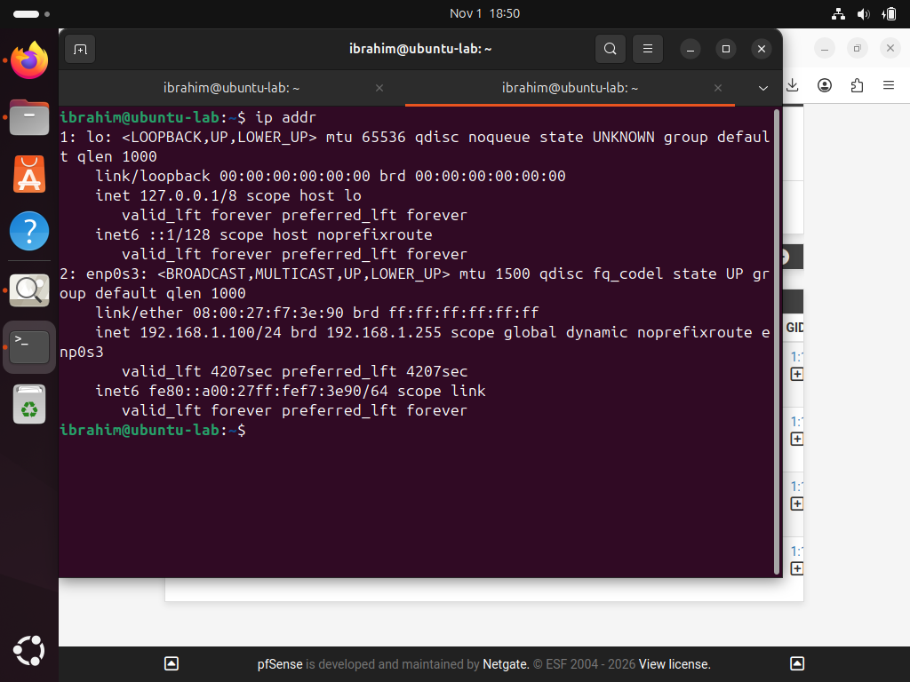

---

## 2. Firewall (pfSense)

**Hardening done first:** changed the default `admin` credentials, because default passwords are one of the most common ways attackers get into network devices.

pfSense works on a **default-deny** model: any traffic a rule does not explicitly allow is blocked. The default LAN rules allow outbound traffic; the WAN side blocks all unsolicited inbound traffic.

To prove I could write and apply my own rule, I added a rule to **block ICMP (ping)** from the Ubuntu host while leaving everything else working. It sits at the top of the LAN ruleset, because pfSense reads rules top-to-bottom and stops at the first match, so rule order matters.

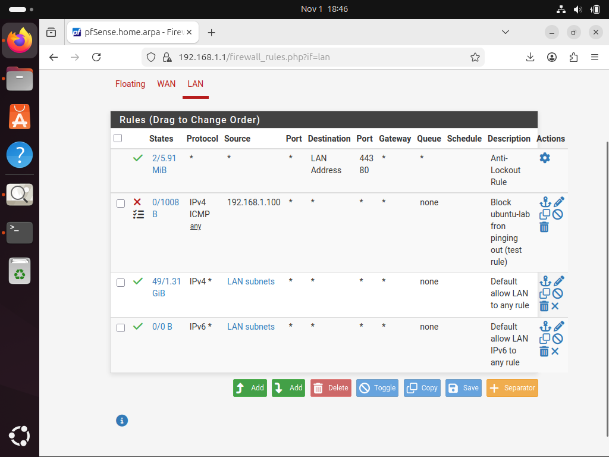

**Testing the rule:** ping now fails (100% packet loss), because the firewall silently drops it...

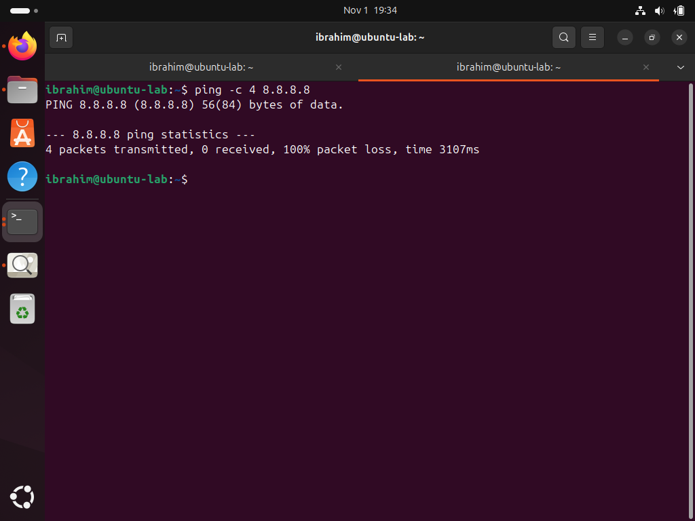

...but normal web traffic still works, proving the rule is precise (it filters one protocol from one host, not everything):

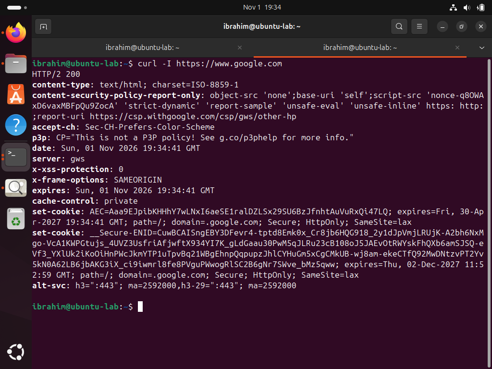

---

## 3. Traffic monitoring (Wireshark)

I captured live traffic on the Ubuntu host to see the firewall's behaviour at the packet level.

**Blocked traffic:** filtering for `icmp` shows the ping *requests* leaving the host, but **no replies** come back. That gap is the firewall dropping the packets.

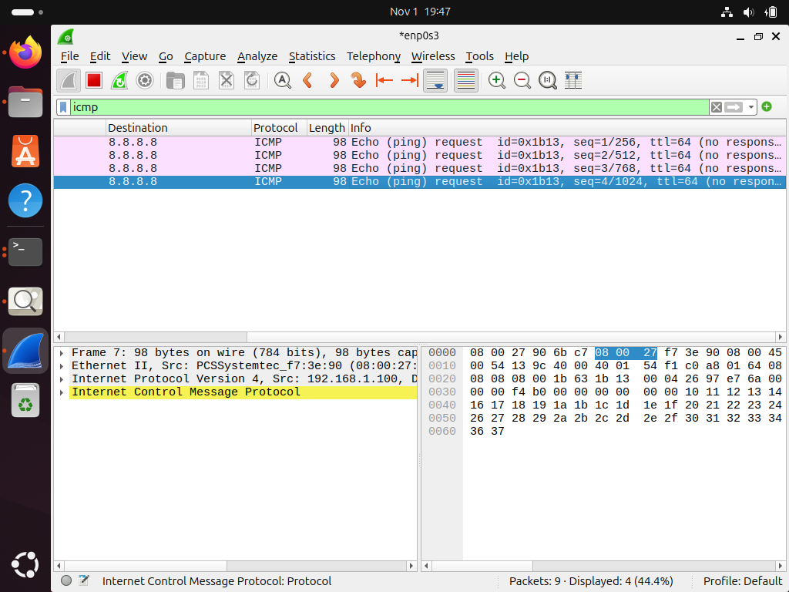

**Allowed traffic:** filtering for `dns` shows full **query and response** pairs for a web lookup. The reply arrives (unlike the ping) because DNS is not blocked. DNS runs over UDP port 53, and here the queries go to pfSense (`192.168.1.1`), which acts as the DNS resolver.

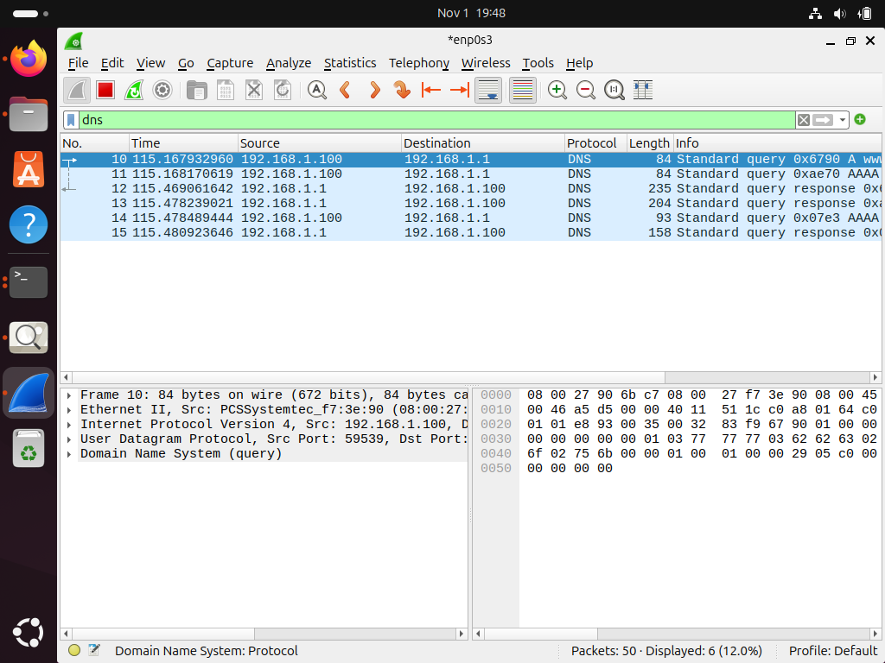

---

## 4. Intrusion detection (Snort)

I installed Snort on pfSense and ran it on the LAN interface in **IDS mode** (detect and alert, not block, this is the difference between IDS and IPS).

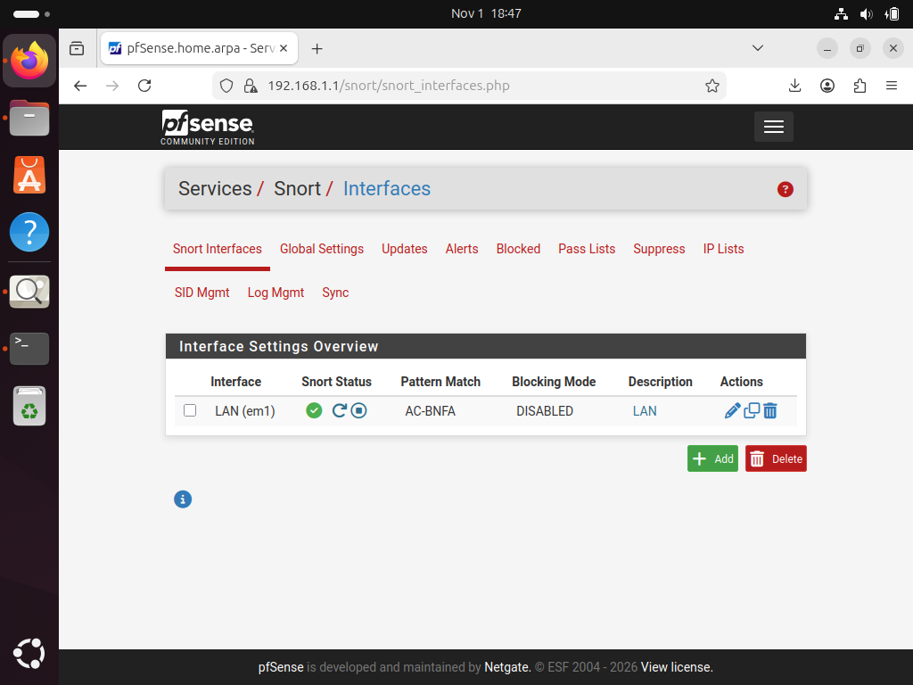

Rather than only using pre-made rule sets, I wrote my own detection signature:

```
alert icmp any any -> any any (msg:"TEST - ICMP ping detected from LAN"; itype:8; sid:1000001; rev:1;)
```

- `alert` – raise an alert
- `icmp ... itype:8` – match ICMP echo requests (pings going out)
- `sid:1000001` – a unique ID (the 1,000,000+ range is reserved for custom rules)

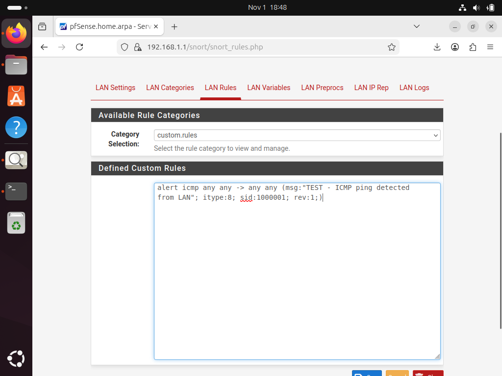

When I pinged out from the Ubuntu host, Snort detected every attempt and logged an alert showing the source (`192.168.1.100`), destination and protocol:

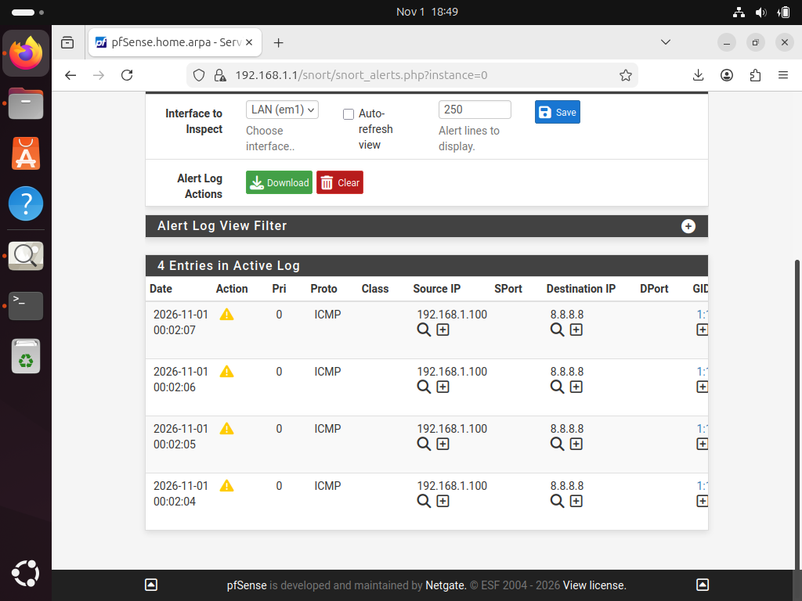

This also demonstrates **defence in depth**: that single ping was handled by two independent layers at once, the firewall **blocked** it *and* the IDS **alerted** on it.

---

## 5. Vulnerability scanning (nmap)

Finally, I scanned the firewall from the Ubuntu host to check its attack surface, every open port is a potential way in.

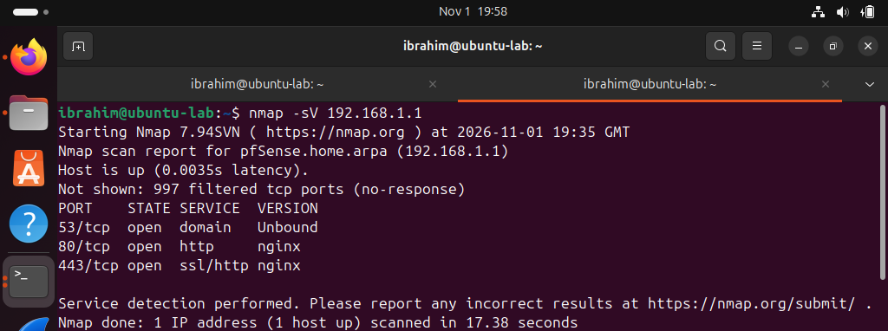

**Reading the result:**
- **997 of 1000 ports are `filtered`** – the firewall is actively dropping probes, so nmap cannot even tell if they are open. This is default-deny working.
- Three ports are open, and all three are legitimate services I run: **53** (DNS / Unbound), **80** (HTTP) and **443** (HTTPS) for the pfSense web interface.

**Finding:** the admin interface is reachable over plain **HTTP (port 80)** as well as HTTPS. Best practice is to disable HTTP and force HTTPS only, so admin credentials can never travel unencrypted. A small, real hardening improvement found by scanning my own setup.

---

## Key concepts I learned

- **Default-deny** and why it is the foundation of firewall design
- **Firewall rule ordering** (top-down, first match wins)
- **Block vs reject** (drop silently vs send a rejection)
- **IDS vs IPS** (detect-and-alert vs detect-and-block)
- **Defence in depth** (multiple independent layers)
- **Attack surface** and how to measure it with a port scan
- Reading traffic at the packet level (the TCP/IP layers, DNS over UDP/53)
- A real limitation of signature-based detection: an IDS only catches what its rules describe

## Limitations and next steps

- Snort was run with a minimal rule set to suit 2 GB of RAM, so a port scan did not trigger an alert (my custom rule only watches ICMP). Next step: enable the Emerging Threats "scan" rule category to catch nmap.
- Disable plain HTTP on the pfSense web interface (the finding above).
- Add a second host to the LAN and experiment with blocking traffic *between* internal hosts (segmentation).
- Try Snort in **IPS mode** to actively block, not just alert.
